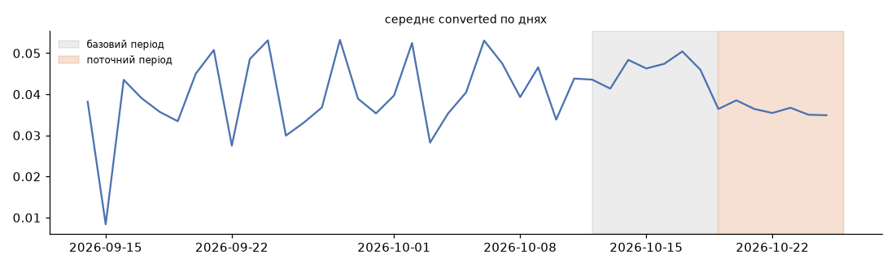
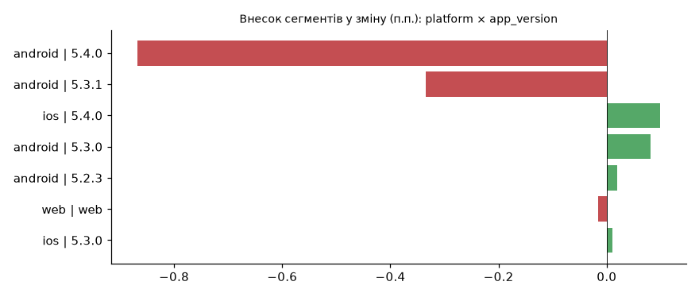

# AI-асистент аналітика (ЛР №4)

CLI-інструмент на Python, який бере на себе рутинну частину роботи продуктового аналітика. Його можна запитати, чому просіла конверсія, які гіпотези варто перевірити, які проблеми є в даних, а також попросити порахувати щось за запитом природною мовою чи написати короткий summary для CEO. На вхід приймає CSV, на вихід дає Markdown-звіт із таблицями й графіками.

Головний принцип: **pandas рахує, LLM (Claude) інтерпретує, код перевіряє**. Модель не бачить сирих рядків і не рахує числа сама. Вона отримує агрегати й статистично відібрані факти, а відповідає строго за JSON-схемою. Кожне число в її тексті модуль `verify.py` автоматично звіряє з фактами, на основі яких писалася відповідь. Непідтверджені числа звіт позначає ⚠️, щоб аналітик перевірив їх вручну.

## Реалізовані функції

| # | Функція | Команда | Що робить pandas/scipy | Що робить LLM |
|---|---|---|---|---|
| 1 | **Автоматичний EDA** | `eda` | типи й ролі колонок, пропуски, квантилі, викиди (IQR), дублікати, сплески по днях, графіки | пояснює, що це за дані; відрізняє помилки від бізнес-значень; дає рекомендації з очищення |
| 2 | **Генерація гіпотез** | `hypotheses` | скринінг фактів: розриви між сегментами (z-test / Mann-Whitney, p < 0.001), аномальні дні, тренди, кореляції | обирає 5–10 найцінніших фактів і формулює гіпотези з причиною та планом перевірки |
| 3 | **Natural Language → Pandas** | `ask` | виконує згенерований код у пісочниці (AST-перевірка безпеки) | генерує код, виправляє його після помилки, відповідає людською мовою; код завжди видно |
| 4 | **Пояснення аномалій** | `anomaly` | точна декомпозиція зміни метрики (mix/rate-ефекти) по розрізах і їхніх парах, контрфактичні сценарії «без сегмента» | формулює гіпотези причини, показує виключені розрізи, оцінює впевненість |
| 5 | **Executive summary** | `summary` | KPI за два періоди (сесії, користувачі, конверсія, виручка, AOV, ARPU) | headline → що сталось → чому важливо → наступні кроки з власником і терміновістю |
| 6 | **Власна: перевірка чисел (anti-hallucination)** | вбудована у всі | витягує числа з тексту LLM і звіряє з фактами (з урахуванням округлення, %, п.п., «у N разів») | — |
| + | **Повний «понеділковий» звіт** | `report` | 1→2→4→5 одним запуском за останній повний тиждень | |

## Швидкий старт

```bash
pip install -r requirements.txt
python generate_data.py                 # створює data/sessions.csv (~98 тис. рядків)
python cli.py --offline report data/sessions.csv   # працює без ключа: лише розрахунки pandas
```

### API-ключ (для LLM-частини)

Ключ кладеться у файл `.env` у корені проєкту (він у `.gitignore`) або в змінну середовища. Підтримуються два варіанти:

**A. Безкоштовно, через OpenRouter.** На цьому варіанті зроблено демо.
1. Зареєструйтеся на <https://openrouter.ai> і створіть ключ у розділі **Keys**. Поповнювати баланс не потрібно.
2. Створіть `.env`:
   ```
   OPENROUTER_API_KEY=sk-or-v1-...
   ANALYST_MODEL=nvidia/nemotron-3.5-super-vl:free
   ANALYST_MAX_TOKENS=32000
   ```
   Моделі з суфіксом `:free` безкоштовні, але мають ліміт запитів: близько 50 на день без поповнення. Повний `run_demo.py` займає близько 22 запитів. Обирайте модель, що підтримує `structured_outputs` (список: <https://openrouter.ai/models>).

**B. Claude.** Офіційний Anthropic API (ключ на <https://console.anthropic.com> → API Keys) або Claude через OpenRouter.
   ```
   ANTHROPIC_API_KEY=sk-ant-...          # або OPENROUTER_API_KEY + ANALYST_MODEL=claude-opus-5-5
   ```
   Без `ANALYST_MODEL` використовується `claude-opus-5-5`. Для OpenRouter ID автоматично перетворюється на `anthropic/claude-opus-5.5`.

Провайдер визначається за ключем: `ANTHROPIC_API_KEY` має пріоритет над `OPENROUTER_API_KEY`. Якщо ключа немає зовсім, інструмент переходить в офлайн-режим: усі розрахунки, таблиці й графіки працюють, а LLM-інтерпретації пропускаються. Виняток — функція `ask`, якій LLM потрібна обов'язково.

## Приклади використання

```bash
# 1. EDA
python cli.py eda data/sessions.csv

# 2. Гіпотези
python cli.py hypotheses data/sessions.csv --min 5 --max 8

# 3. Питання природною мовою (одне або інтерактивний режим без питання)
python cli.py ask data/sessions.csv "Покажи топ-5 країн за виручкою у жовтні 2026"
python cli.py ask data/sessions.csv

# 4. Чому просіла конверсія минулого тижня? (базовий період за замовчуванням — попередній тиждень)
python cli.py anomaly data/sessions.csv --metric converted --period 2026-10-19:2026-10-25
#    інші метрики: count | sum:revenue | ratio:revenue/converted (AOV)
python cli.py anomaly data/sessions.csv --metric ratio:revenue/converted --period 2026-10-19:2026-10-25 --dims channel,country

# 5. Executive summary: з CSV (+ аналіз драйверів) або з готового JSON із метриками
python cli.py summary data/sessions.csv --period 2026-10-19:2026-10-25 --with-drivers converted
python cli.py summary --metrics-json examples/metrics_example.json --audience "marketing lead"

# Усе разом
python cli.py report data/sessions.csv --out reports/weekly
```

Звіт виводиться в консоль і зберігається в `--out` (за замовчуванням `reports/latest/`) разом із PNG-графіками. Повні промпти та відповіді кожного LLM-виклику пишуться в `logs/llm_calls.jsonl`.

Як Python-бібліотека (наприклад, у Jupyter):

```python
from analyst import LLMClient, load_csv, auto_eda, suggest_hypotheses, ask, explain_anomaly
df, llm = load_csv("data/sessions.csv"), LLMClient()
r = explain_anomaly(df, "converted", ("2026-10-19", "2026-10-25"), llm=llm)
r["decomposition"]["primary_candidate"], r["interpretation"], r["verification"].badge()
```

## Демонстрація на даних

```bash
python run_demo.py                      # усі 5 функцій + 8 питань NL→pandas (зокрема крайні випадки)
python run_demo.py --only ask,anomaly   # перезапустити з LLM лише окремі розділи
```

Результати лежать у [demo/](demo/), повні промпти й відповіді кожного виклику — у [logs/llm_calls.jsonl](logs/llm_calls.jsonl). Демо прогнано на безкоштовній моделі `nvidia/nemotron-3.5-super-vl:free` (OpenRouter):

| Файл | Що всередині | Перевірка чисел |
|---|---|---|
| [00_ground_truth.md](demo/00_ground_truth.md) | чи знайдено 6 закладених у дані ефектів | 6/6 ✅ |
| [01_eda.md](demo/01_eda.md) | профіль, 10 проблем якості, інтерпретація, графіки | 93/93 ✅ |
| [02_hypotheses.md](demo/02_hypotheses.md) | 10 гіпотез, кожна з посиланнями на факти F1…F58 | 9/10 повністю ✅; в одній ⚠️ на «14 днів» (хибне спрацювання, виправлено) |
| [03_ask.md](demo/03_ask.md) | 8 питань: 5 звичайних і 3 крайні (погода, LTV за 2 роки, «видали й збережи») | відповіді ✅; в одній ⚠️ — модель написала «5,15 %» через кому, і верифікатор це спіймав |
| [04_anomaly.md](demo/04_anomaly.md) | падіння конверсії 19–25.10 і бот-сплеск 2026-09-15 | 35/35 і 42/42 ✅ |
| [05_summary.md](demo/05_summary.md) | executive summary для CEO | 23/23 ✅ |

Що пішло не так у живих прогонах і як це виправлено, детально описано в [prompts.md → Журнал ітерацій](prompts.md#журнал-ітерацій).

### Датасет

[generate_data.py](generate_data.py) генерує синтетичні дані e-commerce застосунку: **97 830 сесій × 16 колонок** за 2026-08-01..2026-10-31 (канал, платформа, версія застосунку, країна, вік, тривалість, перегляди, кошик, конверсія, виручка тощо). Я свідомо обрав синтетичні дані: у них **закладені відомі ефекти (ground truth)**, тож можна об'єктивно перевірити, чи асистент знаходить реальні причини, а чи вигадує:

| Закладений ефект | Що знайшов асистент (детермінована частина) |
|---|---|
| Android-реліз 5.4.0 (2026-10-19) з багом у checkout | конверсія 4.63% → 3.62% (−21.8%); головний драйвер `platform=android × app_version=5.4.0` пояснює 86% падіння, без нього зміна лише −4.1% |
| Бот-трафік у вівторок 2026-09-15 | день із robust z = 31; сплеск пояснюється `platform=web` (97%), трафік affiliate, 0 конверсій |
| paid_social конвертує гірше | 1.67% проти 4.03% у решти (0.41×, p ≈ 1e-36) |
| email має найвищий чек | виручка на сесію 147 проти 70 (2.12×) |
| Проблеми якості | 120 дублікатів, 40 від'ємних тривалостей, 60 від'ємних виручок (повернення), пропуски age_group і country, викиди виручки |

### Приклад: пояснення падіння конверсії




## Тести

```bash
python -m unittest discover -s tests -v
```

24 тести на крайні випадки: порожній CSV, файл лише із заголовком, неіснуючий файл, період без даних, переплутані дати, неіснуюча чи нечислова метрика, небезпечний код (`import os`, `open`, `__class__`, `to_csv`), повторна спроба після помилки в коді чи зламаного синтаксису, нерелевантне питання, порожнє питання, вигадані числа й неіснуючі id фактів у відповіді LLM, відповідь-заглушка (`"..."`). Три тести відтворюють реальні збої з демо-прогону. Також перевіряється математична точність декомпозиції: сума внесків дорівнює загальній зміні. LLM у тестах підмінено FakeLLM, тому ключ для них не потрібен.

## Структура

```
analyst/
  llm.py          клієнт LLM (Anthropic / OpenRouter): structured outputs, .env, повтор заглушок, логування
  prompts.py      усі промпти та JSON-схеми (пояснення — у prompts.md)
  data.py         завантаження CSV, автовизначення ролей колонок
  eda.py          функція 1
  hypotheses.py   функція 2
  nl2pandas.py    функція 3 (+ AST-пісочниця)
  anomaly.py      функція 4 (декомпозиція mix/rate)
  summary.py      функція 5
  verify.py       функція 6 (перевірка чисел)
  render.py       Markdown-рендеринг
cli.py            CLI
run_demo.py       демонстрація + перевірка ground truth
generate_data.py  генератор датасету
tests/            тести
prompts.md        документація промптів
```

## Технології

Python 3.10+, **pandas**, **numpy**, **scipy** (статистичні тести), **matplotlib** (графіки), **anthropic** (офіційний Python SDK для Claude API), **openai** (клієнт для OpenAI-сумісного API OpenRouter). Модель за замовчуванням — `claude-opus-5-5`; демо зроблене на безкоштовній `nvidia/nemotron-3.5-super-vl:free`. В обох бекендах відповіді отримуються через structured outputs (JSON Schema), а глибина міркувань (`effort`) налаштована окремо для кожної задачі. Для прямого Anthropic API увімкнено server-side fallback: якщо класифікатор безпеки відхиляє запит, API повторює його на резервній моделі. Додатково є повтор запиту, якщо модель повернула заглушки замість змісту.

## Обмеження

* **Пісочниця NL→pandas не є повноцінною ізоляцією.** AST-перевірка та обмежені `__builtins__` відсікають очевидно небезпечний код (імпорти, файли, dunder-атрибути, запис у файли), але `exec` виконується в тому самому процесі. Для продакшну згенерований код варто запускати в окремому контейнері.
* **Перевірка чисел евристична.** «Непідтверджене» число не обов'язково хибне: це може бути коректне похідне значення, яке верифікатор не вміє рахувати. І навпаки, збіг із фактом не гарантує, що число віднесено до правильного сегмента. Тому для гіпотез перевірка звужена до фактів, які гіпотеза процитувала.
* **Автовизначення ролей колонок** (дата, розрізи, метрики) розраховане на «довгі» таблиці подій або сесій. Для інших форматів розрізи можна задати явно (`--dims`).
