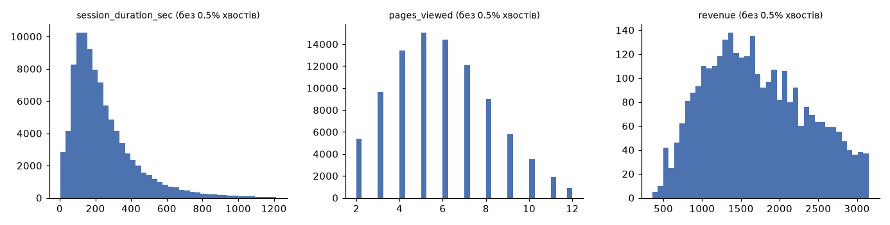
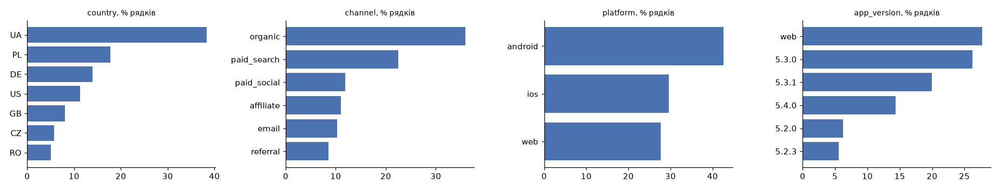
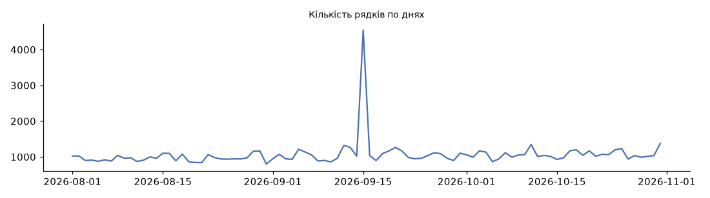

## Автоматичний EDA (функція 1)

**Розмір:** 97 830 рядків × 16 колонок  42.1 MB. **Повних дублікатів:** 120.

**Ролі колонок (визначено автоматично):** date: session_date; dimensions: hour, country, channel, platform, app_version, age_group; binary_metrics: is_new_user, added_to_cart, converted, discount_used; value_metrics: session_duration_sec, pages_viewed, revenue; ids: session_id, user_id

| колонка | тип | пропуски | унікальних | статистики |
|---|---|---|---|---|
| `session_id` | str | 0 (0.0%) | 97710 | S084819: 0.0%, S066074: 0.0%, S076667: 0.0%, S028509: 0.0% |
| `user_id` | str | 0 (0.0%) | 16695 | U09413: 0.1%, U09945: 0.1%, U12341: 0.0%, U07203: 0.0% |
| `session_date` | datetime64[us] | 0 (0.0%) | 92 | 2026-08-01 .. 2026-10-31 (92 днів) |
| `hour` | int64 | 0 (0.0%) | 24 | min 0, median 11.0, mean 11.17, p99 23.0, max 23 |
| `country` | str | 782 (0.8%) | 7 | UA: 38.3%, PL: 17.8%, DE: 13.9%, US: 11.3% |
| `channel` | str | 0 (0.0%) | 6 | organic: 35.9%, paid_search: 22.5%, paid_social: 11.9%, affiliate: 11.0% |
| `platform` | str | 0 (0.0%) | 3 | android: 42.6%, ios: 29.6%, web: 27.7% |
| `app_version` | str | 0 (0.0%) | 6 | web: 27.7%, 5.3.0: 26.3%, 5.3.1: 19.9%, 5.4.0: 14.3% |
| `age_group` | str | 6797 (7.0%) | 5 | 25-34: 33.9%, 35-44: 24.0%, 18-24: 22.7%, 45-54: 11.4% |
| `is_new_user` | int64 | 0 (0.0%) | 2 | частка 1: 52.20% |
| `session_duration_sec` | int64 | 0 (0.0%) | 1578 | min -608, median 194.0, mean 247.05, p99 1014.7100000000064, max 6234 |
| `pages_viewed` | int64 | 0 (0.0%) | 19 | min 1, median 5.0, mean 5.59, p99 12.0, max 19 |
| `added_to_cart` | int64 | 0 (0.0%) | 2 | частка 1: 16.84% |
| `converted` | int64 | 0 (0.0%) | 2 | частка 1: 3.75% |
| `discount_used` | int64 | 0 (0.0%) | 2 | частка 1: 20.25% |
| `revenue` | float64 | 0 (0.0%) | 3644 | min -7800.7, median 0.0, mean 77.58, p99 2459.135200000001, max 72135.75 |

### Проблеми якості (rule-based, pandas)

- **Q1** `*` — fully duplicated rows (count=120, share=0.0012)
- **Q2** `session_id` — values of a key-like column are repeated (count=120)
- **Q3** `country` — missing values (count=782, share=0.008)
- **Q4** `age_group` — missing values (count=6797, share=0.0695)
- **Q5** `session_duration_sec` — negative values in a numeric column (count=40, min=-608)
- **Q6** `session_duration_sec` — values above Q3 + 3*IQR (count=1479, p99=1014.7100000000064, max=6234)
- **Q7** `pages_viewed` — values above Q3 + 3*IQR (count=14, p99=12.0, max=19)
- **Q8** `revenue` — negative values in a numeric column (count=60, min=-7800.7)
- **Q9** `revenue` — among non-zero values: above Q3 + 3*IQR (count=36, median_nonzero=1787.58, max=72135.75)
- **Q10** `session_date` — abnormal number of rows on 2026-09-15 (rows=4540, typical_daily_rows=1014.5)

### Інтерпретація (LLM)

**Що це за дані:** Це дані про сесії користувачів у веб-/мобільному додатку за 92 дні (з 2026-08-01 по 2026-10-31). Один рядок = одна сесія (session_id); у вибірці 97 830 рядків і 16 695 унікальних користувачів, що в середньому дає близько 5.9 сесій на одного користувача. Набір містить мірки (session_date, hour, country, channel, platform, app_version, age_group), бінарні прапори (is_new_user, added_to_cart, converted, discount_used) та числові мірки (session_duration_sec, pages_viewed, revenue).

**Один рядок =** session_id — одна сесія на рядок

**Ключові колонки:**
- `session_duration_sec`: Правобічна асиметрія (skew 2.82). Медіана 194 сек, середнє 247.05 сек, макс 6 234 сек. p99 = 1 014.71 сек, тому maksimum у 6.1 рази вище p99. Є 40 від’ємних значень (мін. −608) — неможливе для тривалості сесії.
- `revenue`: Екстремальна правихirosнутість (skew 49.49). 96.25% рядків мають нульовий дохід; медіана та p75 дорівнюють 0. Среди ненульових: медіана 1 787.58, p99 6 306.58, макс 72 135.75 (у 40.4 рази вище ненульової медіани). Є 60 від’ємних значень (мін. −7 800.7) і 36 екстремальних викидів серед ненульових.
- `pages_viewed`: Слаба асиметрія (skew 0.34), медіана 5, макс 19. p99 = 12, макс у 1.6 рази вище. 14 екстремальних викидів.
- `hour`: Приблизно рівномірний розподіл (skew 0.05), медіана 11, 4.50% сесій о 0 годині.
- `conversion_metrics`: converted = 3.75% (сума 3 670), added_to_cart = 16.84% (сума 16 478), discount_used = 20.25% (сума 19 814), is_new_user = 52.20% (сума 51 071).
- `country`: UA 38.32%, PL 17.75%, DE 13.89%, US 11.31%, GB 8.01%, CZ 5.69%, RO 5.03%. Пропуски: 782 (0.80%).
- `age_group`: Найчастіше 25-34 (33.92%), далі 35-44 (23.99%), 18-24 (22.71%), 45-54 (11.37%), 55+ (8.01%). Пропуски: 6 797 (6.95%).
- `platform`: android 42.62%, ios 29.65%, web 27.73%. app_version містить «web» з тією ж часткою 27.73%, що й platform=web.

**Висновки щодо якості даних:**

| | issues | висновок | помилка? | рекомендація |
|---|---|---|---|---|
| 🔴 | Q1, Q2 | 120 повних дублікатів рядків (0.12% від 97 830) і 120 повторів session_id. Оскільки кількості однакові, це, ймовірно, ті самі рядки; session_id має бути унікальним ключем сесії. | так | Вилучити точні дублікати, залишити одну копію на session_id. Перевірити ETL-конвеєр на подвійне завантаження або дублювання трекінгу. |
| 🟢 | Q3 | 782 пропуски в country (0.80%). | ні | Заповнити як «Unknown» або виключити з гео-звітів, якщо країна обов'язкова. |
| 🟠 | Q4 | 6 797 пропусків в age_group (6.95%) — значна частка для сегментації. | ні | Додати категорію «Unknown» або виконати імпутацію; не видаляти рядки, щоб не втрачати частину аудиторії. |
| 🔴 | Q5 | 40 від’ємних значень session_duration_sec, mín −608. Тривалість сесії не може бути від’ємною — це реальна помилка даних. | так | Видалити або поставити null; надіслати на виправлення джерела збору даних. |
| 🟠 | Q6 | 1 479 екстремальних викидів session_duration_sec (межі IQR3); макс 6 234 сек vs p99 1 014.71 сек. Такі сесії можуть бути легітивними (довгі онлайн-розмови, відкриті вкладки). | ні | Не видаляти автоматично. Обрізати (winsorize) на p99 або аналізувати довгі сесії окремо. |
| 🟢 | Q7 | 14 викидів pages_viewed; макс 19 vs p99 12. Скорее всего це потужні користувачі, а не помилка. | ні | Перевірити вручну; опціонально обрізати на 12. |
| 🟠 | Q8 | 60 від’ємних значень revenue, mín −7 800.7. Можуть бути поверненнями (легітивно) або помилками введення. | ні | Розділити на повернення (refunds) та помилки за транзакційними логами. Якщо повернення — позначити окремим прапором; якщо помилка — скор recti̇вувати. |
| 🟠 | Q9 | 36 екстремальних викидів серед ненульових значень revenue; макс 72 135.75 vs ненульова медіана 1 787.58 (у 40.4 рази вище). Можуть бути тестовими замовленнями або фродом. | ні | Перевірити на тестові замовлення/фрод. Для аналізу доходу використовувати лише ненульову вибірку або обрізати на p99 6 306.58. |
| 🟠 | Q10 | На 2026-09-15 зафіксовано 4 540 рядків vs типові добові 1 014.5 (у 4.5 рази більше). | ні | Перевірити на боти, маркетингову кампанію або дублювання трекінгу у цей день. |

**Додаткові спостереження:**
- Q1 і Q2 описують одне й те саме (120 рядків і 120 повторів session_id), тому це одна проблема, а не дві незалежні.
- stovпчик app_version містить значення «web» з часткою 27.73%, що повністю співпадає з часткою platform=web. Слід перевірити, чи веб-платформа завжди має app_version="web", і чи немає невідповідностей між цими стовпцями.
- converted сумує 3 670, а ненульових доходів 3 610; різниця — 60 сесій, таке ж число, скільки від’ємних доходів. Можливо, 60 сесій мають converted=1, але дохід ≤ 0; варто перевірити відповідність конверсії та доходу.
- Від’ємний дохід −7 800.7 перевищує абсолютне значення ненульової медіани (1 787.58) у 4.4 рази. Велике повернення може бути легітивним, але потребує верифікації.
- Дати в наборі — 2026-08-01 … 2026-10-31. Якщо поточна дата раніша, це можуть бути синтетичні або майбутні дані; без поточної дати перевірити це неможливо.

**Наступні кроки:**
1. Дедуп рядків (Q1, Q2).
1. Обробити від’ємні session_duration_sec (Q5) і розділити від’ємний revenue на повернення та помилки (Q8).
1. Побудувати денну агрегацію: сесії, конверсія, дохід; глибокий розбір piku 2026-09-15 (Q10).
1. Провести кроки конвеєра за country, channel, platform, age_group; розрахувати CR і AOV лише на ненульовому доході.
1. Перевірити відповідність converted vs revenue та консистентність platform / app_version.

**Перевірка чисел:** ✅ усі 93 чисел підтверджені даними
