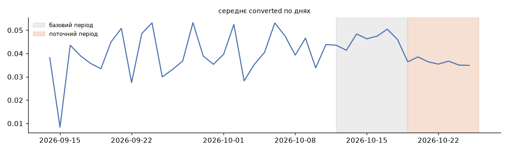
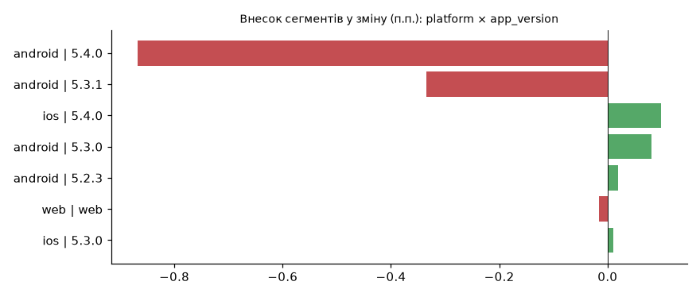
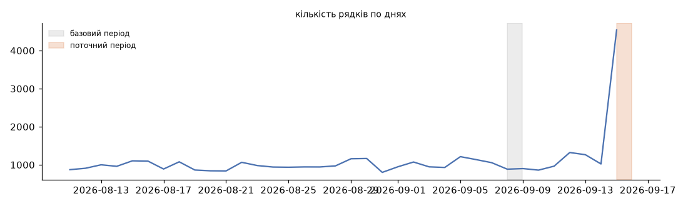
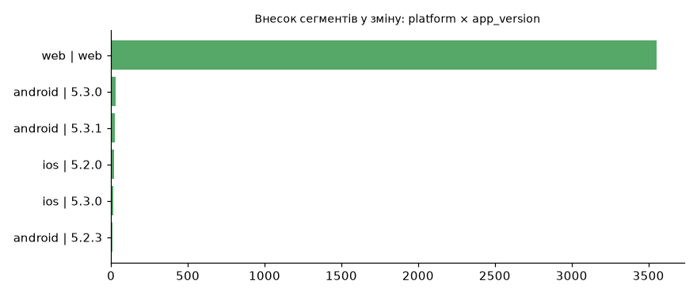

## Пояснення аномалії (функція 4)

**Метрика:** `converted` (середнє converted). **Базовий період:** 2026-10-12..2026-10-18 → **поточний:** 2026-10-19..2026-10-25

**4.63% → 3.62%** (-1.01 п.п., -21.8% відносно)

### Які розрізи найкраще пояснюють зміну

| розріз | концентрація* | головний сегмент | внесок | частка зміни |
|---|---|---|---|---|
| platform | 1.09 | platform=android | -1.10 п.п. | 109% |
| app_version | 0.76 | app_version=5.4.0 | -0.77 п.п. | 76% |
| channel | 0.69 | channel=organic | -0.69 п.п. | 69% |
| country | 0.38 | country=UA | -0.38 п.п. | 38% |
| age_group | 0.29 | age_group=45-54 | -0.29 п.п. | 29% |
| hour | 0.16 | hour=13 | -0.16 п.п. | 16% |
| platform × app_version | 0.86 | platform=android \| app_version=5.4.0 | -0.87 п.п. | 86% |
| platform × channel | 0.51 | platform=android \| channel=organic | -0.52 п.п. | 51% |
| platform × country | 0.35 | platform=android \| country=UA | -0.35 п.п. | 35% |

\* частка загальної зміни, яку пояснює найбільший сегмент розрізу (може бути > 1, якщо інші сегменти рухались у протилежний бік).

**Головний кандидат:** `platform=android | app_version=5.4.0` — значення — → 1.39%, n: 0 → 2088, **новий сегмент** (не існував у базовому періоді)
- Без `platform=android` метрика змінилась би на **+3.7%** (замість -21.8%)
- Без `platform=android | app_version=5.4.0` метрика змінилась би на **-4.1%** (замість -21.8%)

### Інтерпретація (LLM)

**Що сталось:** Середнє converted знизилося з 4.63% у базевому періоді (2026-10-12..2026-10-18) до 3.62% у поточному періоді (2026-10-19..2026-10-25). Абсолютна зміна: -1.01 відсоткового пункту; відносна зміна: -21.78%. Обсяг даних виріс з 7 327 до 7 792 рядків, тому спадок не викликано зменшенням вибірки.

**Головний драйвер:** `platform=android | app_version=5.4.0` (platform × app_version) — Сегмент новий: base_n = 0, base_share = 0.0. У поточному періоді cur_n = 2 088 (cur_share = 26.8%), а його конвертація — 1.39%, що набагато нижче загального поточного значення 3.62%. Весь внесок сегменту припадає на mix_effect (-0.008676); rate_effect = 0.0, оскільки в базі сегмент не існував. Розподіл за парою platform + app_version має концентрацію 86.1%, а сам цей сегмент чітноє 86.1% усього зміни. Виключення цього сегменту з метрики зменшує відносну зміну з -21.78% до -4.13% (поточне значення без сегменту 4.44% проти базового 4.63%).

**Гіпотези причини:**
- **Нова версія додатка / реліз Android 5.4.0** (впевненість: medium)  
  Підстави: Сегмент з’явився лише у поточному періоді, швидко забирав 26.8% трафіку і має низьку конвертацію 1.39%. Довідка mix_effect свідчить, що напрямує зміна трафікового миксу Mechanics способствовала загальному спаданню.  
  Як перевірити: Переглянути реліз-ноти Android 5.4.0 та дату виходу; порівняти кроки воронки конвертації для platform=android | app_version=5.4.0 з platform=ios | app_version=5.4.0 та старішими версіями Android у поточному періоді.
- **Проблема з трекінгом / інструментуванням для Android 5.4.0** (впевненість: medium)  
  Підстави: Новий сегмент без базових даних та надзвичайно низька конвертація 1.39% порівняно з platform=ios | app_version=5.4.0 (5.47% у поточному періоді) можуть свідчити про те, що події конвертації не ліщуються.  
  Як перевірити: Перевірити інструментування та події конвертації для нової версії (чи надходять події, чи не змінено ідентифікатори подій).
- **Зміна трафікового миксу через широке adotвання нової версії** (впевненість: high)  
  Підстави: mix_effect для сегменту (-0.008676)説лю 86.1% зміни; те саме підтверджується метрикою metric_without_segment для platform=android | app_version=5.4.0 (відносна зміна без сегменту -4.13%). Це описує механізм, але не причину низької конвертації всередині сегменту.  
  Як перевірити: Проаналізувати когорти за датою оновлення чи інсталяції: чи низька конвертація лише у користувачів, що оновилися на 5.4.0, чи й у нових інсталяціях.
- **Сезонність або денний розподіл** (впевненість: low)  
  Підстави: Не підтримується даними: розподіл за hour має концентрацію лише 16.1%, а змін розкрашені (наприклад, hour=22 має позитивний внесок).  
  Як перевірити: Перевірити денні значення converted за весь період і порівняти з аналогічними тижнями минулого.

**Що виключено:**
- /dimension hour: концентрація 0.161, найбільший внесок — 16.1%, але частина годин дає позитивний внесок (hour=22), тому вираженого часового шаблону немає.
- /dimension age_group: конвертація впала подібно у всіх вікових групах (концентрація 0.289), немає однієї доминируючої групи.
- /dimension country: спадання зафіксовано одночасно в UA, DE, US, PL і GB (концентрація 0.376), одна країна не пояснює основну частину зміни.
- /dimension channel: хоча channel=organic дає найбільший окремий внесок (-0.006924, 68.7%), розподіл за platform + channel показує, що ефект вище на конкретному поєднанні платформи та версії, а не на каналі загалом. Канал сам по собі недостатній для причинного пояснення.

**Застереження:**
- Кореляція зміни з сегментом не є доводом причинно-наслідкового зв’язку. Відсутність base_value для platform=android | app_version=5.4.0 не дозволяє сказати, як саме змінилася конвертація всередині цього сегменту; можна лише утвердити, що він новий, великий за обсягом і має низьку поточну конвертацію.

**Перевірка чисел:** ✅ усі 35 чисел підтверджені даними

---

### Другий кейс: сплеск сесій 2026-09-15 (vs вівторок тижнем раніше)

## Пояснення аномалії (функція 4)

**Метрика:** `count` (кількість рядків). **Базовий період:** 2026-09-08..2026-09-08 → **поточний:** 2026-09-15..2026-09-15

**884.00 → 4 540.00** (+3 656.00, +413.6% відносно)

### Які розрізи найкраще пояснюють зміну

| розріз | концентрація* | головний сегмент | внесок | частка зміни |
|---|---|---|---|---|
| platform | 0.97 | platform=web | +3 554.0 | 97% |
| app_version | 0.97 | app_version=web | +3 554.0 | 97% |
| channel | 0.96 | channel=affiliate | +3 528.0 | 96% |
| age_group | 0.96 | age_group=(missing) | +3 508.0 | 96% |
| country | 0.38 | country=UA | +1 397.0 | 38% |
| hour | 0.18 | hour=1 | +644.0 | 18% |
| platform × app_version | 0.97 | platform=web \| app_version=web | +3 554.0 | 97% |
| platform × channel | 0.96 | platform=web \| channel=affiliate | +3 510.0 | 96% |
| app_version × channel | 0.96 | app_version=web \| channel=affiliate | +3 510.0 | 96% |

\* частка загальної зміни, яку пояснює найбільший сегмент розрізу (може бути > 1, якщо інші сегменти рухались у протилежний бік).

**Головний кандидат:** `platform=web | app_version=web` — значення 210.00 → 3 764.00, n: 210 → 3764
- Без `platform=web` метрика змінилась би на **+15.1%** (замість +413.6%)
- Без `platform=web | app_version=web` метрика змінилась би на **+15.1%** (замість +413.6%)

### Інтерпретація (LLM)

**Що сталось:** Метрика «кількість рядків» зросла з 884 рядків у базовий період (2026-09-08..2026-09-08) до 4 540 рядків у поточний період (2026-09-15..2026-09-15). Абсолютний приріст: 3 656 рядків (+413.6% від базового значення, у 5.1 рази по сравненні з базою).

**Головний драйвер:** `platform=web | app_version=web` (platform × app_version) — Внесок сегменту: 3 554 рядки (97.2% усього зміни); значення зросло з 210 до 3 764 рядків. Парний розподіл не показує чітко вищої концентрації, ніж одиничний розмір за platform (0.972 vs 0.972), оскільки у цих даних app_version=web совіпає з platform=web. При виключенні platform=web метрика змінювалася б лише з 674 до 776 рядків (+15.1%), що підтверджує доминируючу роль веб-сегменту.

**Гіпотези причини:**
- **Новий веб-реліз або зміна відслідковування на веб-платформі (наприклад, оновлення скрипта, A/B-тест або подвійне trigger подій).** (впевненість: medium)  
  Підстави: platform=web | app_version=web дає 97.2% усього зміни; без вебу приріст лише +15.1% (674 -> 776).  
  Як перевірити: Перевірити логи веб-сайту та реалізацію трекінгу між 2026-09-08 і 2026-09-15 наявність нового релізу, зміни пікселя або дублювання подій для platform=web / app_version=web.
- **Переливання трафіку у канал affiliate на веб-платформі (новий партнерська кампанія або реферальне посилання).** (впевненість: medium)  
  Підстави: У парному розрізі platform + channel сегмент platform=web | channel=affiliate дає внесок 3 510 рядків (96.0% зміни), значення зросло з 22 до 3 532 рядків.  
  Як перевірити: Проаналізувати джерела channel=affiliate на platform=web — чи з’явився новий партнер, 캠аней або реферальне посилання, що могло привести до стрибку з 22 до 3 532 рядків.
- **Проблема з заповненням віку (age_group=(missing)) для нового веб/афілієтного трафіку — можливо, симптом, а не причина.** (впевненість: medium)  
  Підстави: age_group=(missing) дає внесок 3 508 рядків (96.0% зміни), значення зросло з 25 до 3 533 рядків, що відповідає масштабу веб-сегменту.  
  Як перевірити: Перевірити чистоту даних age_group: чи не перестав заповнятися поле для веб/афілієтних користувачів.
- **Зміна в інших мобільних платформах або версіях не є основним драйвером.** (впевненість: high)  
  Підстави: platform=android (+67) і platform=ios (+35) дають лише 1.8% і 1.0% зміни; інші app_version (5.3.0, 5.3.1, 5.2.0, 5.2.3) дають від 11 до 46 рядків.  
  Як перевірити: Нічого додатково перевіряти не потрібно для виключення, оскільки внески незначні.

**Що виключено:**
- :country: концентрація 0.382; найбільший внесок country=UA — 1 397 рядків (38.2%), але зміна розподілена між UA, PL, DE, US, GB, жодна країна не доминирує
- :hour: концентрація 0.176; найбільший внесок hour=1 — 644 рядки (17.6%), але внепи по годинах (0, 2, 3, 4 тощо) схожі, однієї години недостатньо для пояснення загального зросту
- platform=android, platform=ios, інші app_version (5.3.0, 5.3.1, 5.2.0, 5.2.3), інші channel (paid_search, referral, email, paid_social): їхні внепи значно менші (від 11 до 67 рядків) і разом не пояснюють більшість зміни

**Застереження:**
- Кореляція зміни з сегментом не є доказом причинно-наслідкового зв’язку; основна гіпотеза потребує технічної перевірки.
- Відомості про mix_effect і rate_effect не надані у детальному розподілі, тому не можна розділити приріст на зміну трафіку та зміну рівня всередині сегменту на основі цього звіту.

**Перевірка чисел:** ✅ усі 42 чисел підтверджені даними
